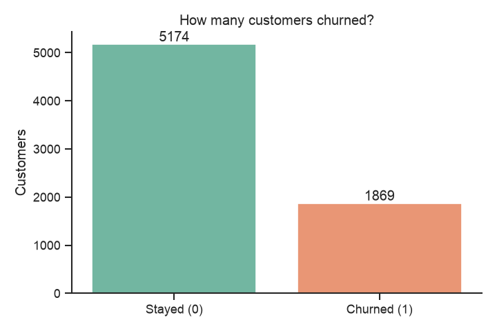
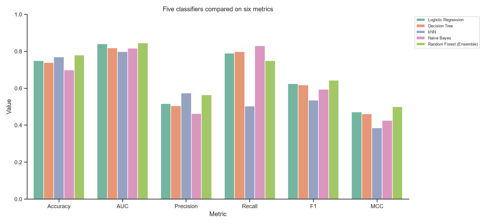
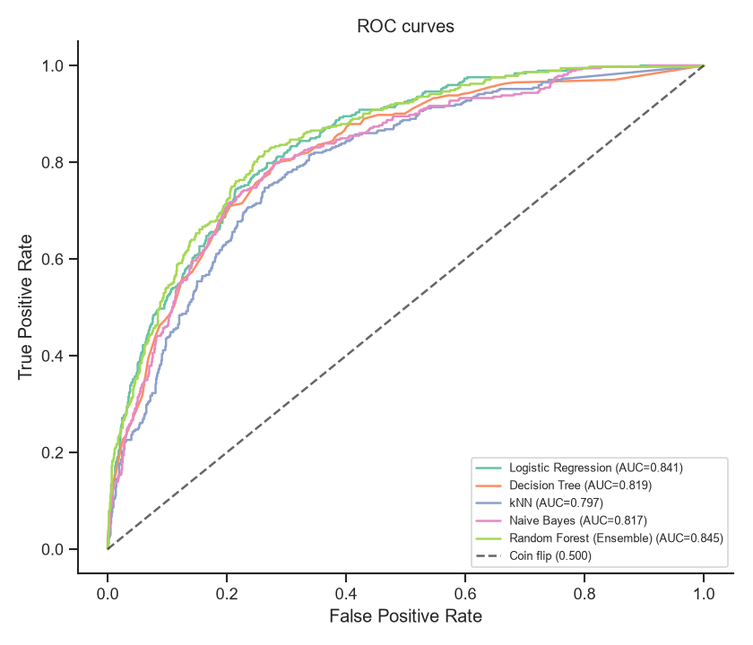
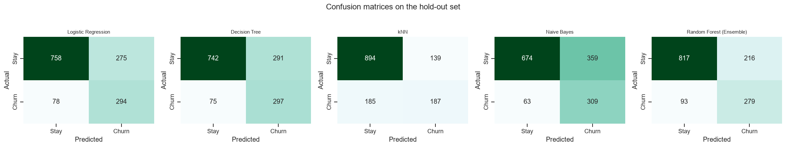

# Telecom Customer Churn — A Classification Study

A beginner-friendly machine-learning project that predicts whether a telecom
customer will **churn** (leave) or **stay**, comparing five classification
algorithms across six evaluation metrics. Because the dataset is imbalanced, the
models are deliberately **class-weighted** to take the rare "churn" cases
seriously.

---

## 1. Problem Statement

Telecom companies lose revenue whenever a customer cancels their service
("churn"). If we can **flag likely churners early**, the business can step in with
retention offers. We frame this as a **supervised binary classification** task:

> Given a customer's account, service and billing details, predict whether the
> customer will churn (`Yes` → `1`) or not (`No` → `0`).

We build, cross-validate and compare five classic classifiers, then pick the best
one for this dataset.

---

## 2. Dataset Description

| Property | Value |
|---|---|
| **Name** | Telco Customer Churn |
| **Source** | IBM Sample Data Sets (publicly mirrored; also on [Kaggle](https://www.kaggle.com/datasets/blastchar/telco-customer-churn)) |
| **Download URL used** | `https://raw.githubusercontent.com/IBM/telco-customer-churn-on-icp4d/master/data/Telco-Customer-Churn.csv` |
| **Local filename** | `data/telco_customers.csv` |
| **Instances (rows)** | 7,043 customers (≥ 1,000 ✓) |
| **Features (columns)** | 19 usable features after dropping the ID (≥ 12 ✓) |
| **Target variable** | `Churn` (binary: `Yes` / `No`) |
| **Missing values** | Yes — 11 hidden blanks in `TotalCharges` (handling required ✓) |
| **Class balance** | Imbalanced — 73.5% `No`, 26.5% `Yes` (examined ✓) |

### Why this dataset was selected
- It comfortably exceeds the size requirements (7,043 rows, 19 features).
- It mixes **15 categorical + 4 numeric** features, so it demonstrates **both
  one-hot encoding and feature scaling**.
- It has **real hidden missing values** (`TotalCharges` stored as text with blanks),
  so missing-value handling is a genuine step.
- It is naturally **class-imbalanced**, which makes the imbalance analysis and the
  choice of robust metrics (AUC, F1, MCC) meaningful.
- Churn is a relatable real-world business problem — easy to reason about while
  learning.

### Target variable
`Churn` — encoded `1` = churned (**positive** class) and `0` = stayed.

### Feature types
- **Numeric (4):** `SeniorCitizen`, `tenure`, `MonthlyCharges`, `TotalCharges`
- **Categorical (15):** `gender`, `Partner`, `Dependents`, `PhoneService`,
  `MultipleLines`, `InternetService`, `OnlineSecurity`, `OnlineBackup`,
  `DeviceProtection`, `TechSupport`, `StreamingTV`, `StreamingMovies`, `Contract`,
  `PaperlessBilling`, `PaymentMethod`
- **Dropped:** `customerID` (a unique identifier with no predictive value)

### Class distribution
| Class | Count | Proportion |
|---|---|---|
| `No` (stayed) | 5,174 | 73.46% |
| `Yes` (churned) | 1,869 | 26.54% |

Imbalance ratio ≈ **2.77 : 1**. We preserve this ratio with a **stratified** split,
**re-weight the classes** inside the models that support it, and lean on
imbalance-robust metrics (AUC, F1, MCC).



---

## 3. GitHub Repository Link

> **Repository:** [https://github.com/2026ct05189-hub/customer-churn-ml-classification](https://github.com/2026ct05189-hub/customer-churn-ml-classification)

### Repository structure
```
customer-churn-ml-classification/
│-- requirements.txt              # Python dependencies
│-- README.md                     # This file
│-- test_data.csv                 # Held-out 20% test set (features + true label)
│-- .gitignore
│-- data/
│   └-- telco_customers.csv        # Source dataset
│-- model/
│   │-- telco_churn_pipeline.py    # Main, heavily-commented training script
│   │-- telco_churn_analysis.ipynb # Step-by-step teaching notebook (with outputs)
│   │-- score_customers.py         # Loads a saved model and scores test_data.csv
│   │-- clf_logreg.joblib          # Saved Logistic Regression pipeline
│   │-- clf_dtree.joblib           # Saved Decision Tree pipeline
│   │-- clf_knn.joblib             # Saved kNN pipeline
│   │-- clf_gnb.joblib             # Saved Gaussian Naive Bayes pipeline
│   └-- clf_rforest.joblib         # Saved Random Forest pipeline
│-- outputs/
    │-- metrics_comparison.csv     # Results table as CSV
    │-- class_distribution.png
    │-- metrics_comparison.png
    │-- roc_curves.png
    └-- confusion_matrices.png
```

---

## How to Run

```bash
# 1. Install dependencies
pip install -r requirements.txt

# 2. Train all 5 models + generate metrics, plots, saved models and test_data.csv
python model/telco_churn_pipeline.py

# 3. (Optional) Load the best saved model and score the held-out test set
python model/score_customers.py
```

Or open **`model/telco_churn_analysis.ipynb`** in Jupyter and choose
**Kernel → Restart & Run All** (recommended for the Virtual Lab screenshot).

`requirements.txt` pins the exact library versions used (tested with Python 3.14).
Logistic Regression, Decision Tree, kNN and Naive Bayes reproduce the results below
exactly on any machine. The Random Forest can differ in the 2nd–3rd decimal place
between operating systems (e.g. Windows vs. Linux/macOS) because of platform-level
differences in its random sampling; the results reported here were produced on Windows.

---

## Preprocessing (Step 2)

All learned preprocessing is wrapped in a scikit-learn `Pipeline` + `ColumnTransformer`
so it is **fitted on the training data only** — this prevents **data leakage** and
keeps the test scores honest.

| Step | What we did | Why |
|---|---|---|
| **Drop identifier** | Removed `customerID` | A unique code has no predictive signal |
| **Fix hidden missing values** | Converted `TotalCharges` text → numeric; blanks → `NaN` | They were stored as text, hiding 11 missing values |
| **Impute missing values** | Numeric → **median**; categorical → **most frequent** | Fill gaps without distorting the data; fitted on train only |
| **Remove duplicates** | `drop_duplicates()` (22 exact-duplicate rows removed) | Duplicates bias the model and inflate scores |
| **Encode categoricals** | **One-Hot Encoding** (`handle_unknown='ignore'`) | Models need numbers; one-hot avoids a fake category order |
| **Scale numerics** | **StandardScaler** (mean 0, std 1) | Keeps distance-based models (kNN) and Logistic Regression fair |
| **Encode target** | `Yes → 1`, `No → 0` | Positive class = churn |
| **Handle imbalance** | `class_weight='balanced'` (LR, DT) / `'balanced_subsample'` (RF) | Make the rare churn class count more during training |
| **Train/test split** | **80 / 20**, `stratify=y`, `random_state=2026` | Hold out unseen data; keep class ratio; reproducible |
| **Cross-validation check** | 5-fold stratified CV AUC on the training set | Confirm the AUC is stable, not a lucky split |

Resulting split: **5,616 training rows** and **1,405 test rows**, with the churn rate
preserved at ~0.264 (train) and ~0.265 (test).

---

## 4. Models Used

Five classifiers trained on the **same** preprocessed data. Each uses my own chosen
settings; `class_weight` is enabled where the model supports it (kNN and Gaussian
Naive Bayes have no such option, so for those we rely on the stratified split and the
robust metrics).

| Model | Key configuration | One-line intuition |
|---|---|---|
| **Logistic Regression** | `C=0.3`, `class_weight='balanced'`, `solver='liblinear'` | Best linear boundary between classes |
| **Decision Tree** | `criterion='entropy'`, `max_depth=7`, `min_samples_leaf=25`, `class_weight='balanced'` | A flow-chart of yes/no questions |
| **k-Nearest Neighbors** | `n_neighbors=21`, `weights='distance'`, `p=1` (Manhattan) | Predicts from the closest customers |
| **Naive Bayes (Gaussian)** | `var_smoothing=1e-8` | Probability-based; assumes bell-curved features |
| **Random Forest (Ensemble)** | `n_estimators=250`, `max_depth=10`, `min_samples_leaf=5`, `max_features='sqrt'`, `class_weight='balanced_subsample'` | Many trees vote together |

### Evaluation Metrics — Comparison Table

All metrics are computed on the **held-out 20% test set** (reproducible with
`random_state = 2026`).

| ML Model Name | Accuracy | AUC | Precision | Recall | F1 | MCC |
|---|---|---|---|---|---|---|
| **Logistic Regression** | 0.7488 | 0.8407 | 0.5167 | 0.7903 | 0.6249 | 0.4711 |
| **Decision Tree** | 0.7395 | 0.8189 | 0.5051 | **0.7984** | 0.6188 | 0.4621 |
| **kNN** | 0.7694 | 0.7974 | **0.5736** | 0.5027 | 0.5358 | 0.3848 |
| **Naive Bayes** | 0.6996 | 0.8165 | 0.4626 | 0.8306 | 0.5942 | 0.4268 |
| **Random Forest (Ensemble)** | **0.7801** | **0.8448** | 0.5636 | 0.7500 | **0.6436** | **0.4996** |

> **Bold** = best value in that column.

**5-fold cross-validation AUC (training set, stability check):**
LR 0.846 · Decision Tree 0.823 · kNN 0.802 · Naive Bayes 0.819 · **Random Forest 0.846**.
The hold-out AUCs line up with these, so the results are stable (not a lucky split).

**Metric meanings (quick reference):**
- **Accuracy** — fraction of all predictions correct.
- **AUC** — how well the model *ranks* churners above non-churners (0.5 = random); robust to imbalance.
- **Precision** — of predicted churners, how many actually churned.
- **Recall** — of real churners, how many we caught.
- **F1** — harmonic mean of precision and recall.
- **MCC** — balanced score (−1..+1); stays honest under class imbalance.

---

## 5. Visualizations (Graph Representation)

**All metrics, all models:**



**ROC curves (visual form of the AUC score):**



**Confusion matrices (where each model makes mistakes):**



---

## 6. Observations on Model Performance

Because every model (that supports it) is **class-weighted**, they all lean toward
**catching churners** — notice the high recall and the lower precision/accuracy
compared with un-weighted defaults. This is intentional: in churn problems, missing a
real churner usually costs more than a false alarm.

| ML Model Name | Observation about model performance |
|---|---|
| **Logistic Regression** | Excellent all-rounder: tied-best AUC (0.841) and strong recall (0.790). Class weighting trades accuracy (0.749) for catching far more churners. Simple, fast and interpretable — the relationship is largely linear after encoding/scaling. |
| **Decision Tree** | **Highest recall (0.798)** — it flags the most churners — but the lowest precision among the tree-based models, so accuracy (0.740) suffers. Depth was capped at 7 with a leaf minimum to prevent overfitting. Interpretable but less stable than the ensemble. |
| **kNN** | A different trade-off: **highest precision (0.574)** but by far the **lowest recall (0.503)** and AUC (0.797). Because it has no class-weight option it stays conservative, and the one-hot feature space (the "curse of dimensionality") also hurts distance-based methods. |
| **Naive Bayes** | High recall (0.831) but weak precision (0.463), giving the lowest accuracy (0.700). Its "all features independent" assumption doesn't hold here (e.g. the service columns are related), which hurts precision. Good if the goal is simply "don't miss churners". |
| **Random Forest (Ensemble)** | **Best overall** — top AUC (0.845), F1 (0.644), MCC (0.500) and accuracy (0.780), with strong recall (0.750). Averaging many de-correlated trees gives the best balance of catching churners while staying precise. The clear winner for this dataset. |
| **Overall Winner for this dataset** | **🏆 Random Forest (Ensemble)** — leads on AUC, F1, MCC and accuracy. If the only goal were to *catch as many churners as possible* (max recall), the **Decision Tree** or **Naive Bayes** would edge it out, but the Random Forest gives the best overall balance. |

### Key takeaways
- **Accuracy alone is misleading** here: a "predict everyone stays" baseline scores
  ~0.73 while being useless, so we emphasize **AUC, F1 and MCC**.
- **Class weighting reshapes the trade-off:** it boosts recall (we catch more
  churners) at the cost of precision and raw accuracy — the right call when a missed
  churner is expensive.
- **The ensemble won:** the Random Forest beat the single models by combining many
  trees, but the much simpler Logistic Regression was a very close second on AUC.

---

## 7. Virtual Lab Execution Screenshot

> 📸 **Add your screenshot here** after running the project on the BITS Virtual Lab.
>
> ```markdown
> 
> ```
>
> Suggested: run `model/telco_churn_analysis.ipynb` with **Restart & Run All** and
> capture the leaderboard + comparison chart.

---

## Reproducibility & Academic Integrity

- A fixed random seed (`random_state = 2026`) is used for the split and all
  stochastic models, so results are reproducible (see the Random Forest note under
  "How to Run").
- All learned preprocessing is fitted on the training set only (via `Pipeline`),
  preventing data leakage.
- A 5-fold cross-validation check confirms the hold-out results are stable.
- Dataset source and download URL are documented above for verification.
